# ONDA

[Português (Brasil)](README.md) | [Español](README.es.md) | **English**

[Official website](https://enzoandradee16.github.io/Onda/)

A free, open-source, **ad-free** app for Windows and Android. It brings together tools to download, organize and edit music, videos and images, with a Portuguese interface and Spanish and English support.

ONDA started as a personal project, initially made for me and my friends. I decided to share it with anyone who might find it useful to have these tools in one place, without ads and with options to customize the experience.

The project is still in development. Suggestions, contributions and bug reports are welcome.

**Version 1.1.4 for Windows 10 or later (x64) and Android 8 or later (ARM64).**

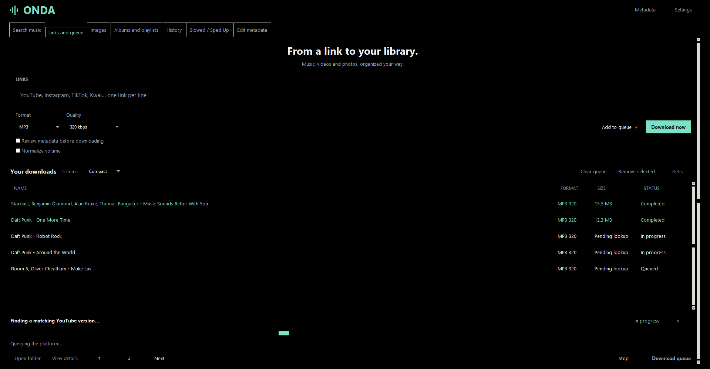

On Android, updates can download within ONDA, with progress and background continuation. When finished, tap Install update; the first time, allow installation from ONDA in Android settings. The system asks for confirmation and your data is preserved.

On PC, right-click lists or cards to open the actions available in that tab. Shift+F10 and the menu key also open these options; an existing multiple selection is preserved when clicking one of its selected items.

## Library and organization

- Detects repeated links in the queue with the same format and options, and in history with the same format. Recognizes short links, locale paths and sharing parameters from Spotify, YouTube and Deezer; asks before adding again. Detection can be disabled in Settings → Downloads. Different playlists, formats and conversions remain independent.
- Batch edits metadata from multiple local files or a multiple selection in History. Select the fields to change and optionally apply a common cover. Unchecked fields are preserved. Copies are created by default; replacing originals requires confirmation. Each file is saved separately and failures are reported at the end.
- Offers folders by album, artist/year/album, genre/artist/album and format/artist/album, alongside the existing options. File names can include track number, artist, track title and disc number. Settings shows a preview. Playlist folders are preserved and missing track numbers are omitted.

On Android, source identification in history is recorded for new downloads; older entries without a source link are not identified solely by their file names. Detection does not compare audio or treat similar titles as proof of duplication.

## Download and launch

Download the official packages from [Releases](https://github.com/enzoandradee16/Onda/releases). Choose the Windows or Android version; source code and build instructions are also available in this repository.

- **Portable:** extract the entire ZIP and open `Onda.exe`. Keep the `Onda` and `_runtime` folders alongside it. You do not need to install Python. On first use, ONDA downloads FFmpeg directly from gyan.dev, with a progress bar and SHA-256 verification; this initial setup requires an internet connection.
- **Installer:** run `Onda-…-Setup-Windows-x64.exe` and follow the wizard. Installation is per user, with shortcuts and an uninstaller. FFmpeg is also prepared automatically on first use.
- **Android:** the APK is signed with the production key and requires an ARM64 device running Android 8 or later. Source code for the rebuilt native tools is provided in the Fontes-nativos-Android package attached to the same release.
- **Source code:** see the [development instructions](Onda/README.md) (in Portuguese).

The Windows executables are not digitally signed. Windows may show a reputation warning; check the source and file hashes before running them.

## Language

Version 1.1.4 includes **Português (Brasil)**, **Español** and **English**, in that order, under **Settings → General → Language**. The 1.1.4 packages are prepared locally; publishing them on GitHub is a separate step. Portuguese remains the default language. The name **ONDA** stays the same in every language. Both interfaces use the same translation catalog. The change takes effect immediately on Android; on Windows, restart the app. Your choice is saved even when “Remember settings” is disabled. Song, artist, album and file names remain unchanged.

On Android, the home-screen and recent-apps icons follow the accent color and light, dark, pure black or system appearance. Some launchers may take time to refresh the icon or require recreating an older shortcut.

“Remember settings” is enabled by default on PC and Android. If you disable it manually, that choice is preserved after reopening.

On Android, symbol buttons, selectors, checkboxes and playback/effects sliders expose names and states to TalkBack and accessibility services. Artwork cropping offers actions to move the image without dragging. Descriptions follow the selected language.

## Queue and restart

In **Links and queue**, choose compact or card view and adjust card size with the subtle control on the page. On Windows, **Ctrl + mouse wheel** also changes card size. Queue and history sizes are independent. Full cards show artwork, artist, album, duration and other metadata supplied by the source. In History, Clear history, view and size controls are aligned horizontally and centered below search. Display options are also available under Appearance. Queue and history views and card sizes are restored after reopening, even when “Remember settings” is disabled.

On Windows, **Restart** appears below Language only while a language change is pending. Returning to the current language clears the pending change. Restarting preserves the queue; ongoing operations must finish first. On Android, language and appearance changes apply immediately, without restarting.

## Features

- Searches for music on Deezer, Apple Music and Spotify, retrieving metadata and artwork. Connecting to Spotify is optional and expands search and playlist features.
- For tracks from streaming catalogs, MP3/M4A use a matching version from YouTube. FLAC uses the Monochrome catalog when a compatible match is available, with audio validation and version selection.
- Downloads video, audio and image links, including social media posts with multiple media items, when accessible.
- Provides a persistent queue, immediate downloads, history, media selection and folder organization.
- Imports albums and playlists, as well as TXT, M3U and Exportify CSV files. You can search within the list and choose separate format and quality settings for it.
- Converts images and creates Slowed, Sped Up and Reverb versions, with presets, previews, playback seeking and an option to preserve pitch.
- Offers light, dark, pure black and system themes, 16 accent colors and reorderable tabs.

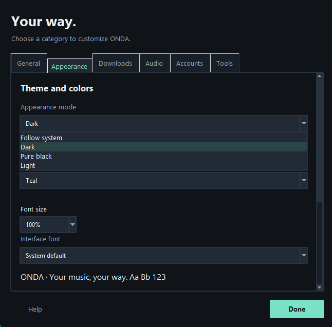

## ONDA on Windows

Real screenshots of the English interface. Click to enlarge.

<table>
  <tr>
    <td align="center" width="50%">
      <strong>Search music</strong> 
      <a href="docs/images/pc/en/pesquisa-escuro.png">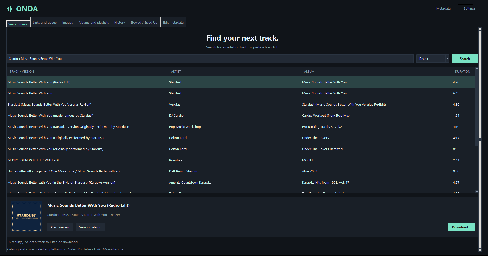</a> 
      Dark · Teal
    </td>
    <td align="center" width="50%">
      <strong>Edit metadata</strong> 
      <a href="docs/images/pc/en/metadados-preto-puro.png">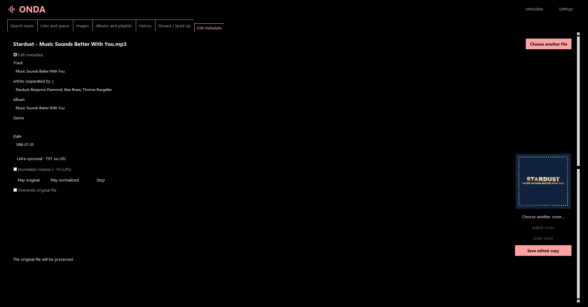</a> 
      Pure black · Red <a href="docs/images/pc/en/ajustar-capa.png">View cover adjustment</a>
    </td>
  </tr>
  <tr>
    <td align="center" width="50%">
      <strong>Images</strong> 
      <a href="docs/images/pc/en/imagens-claro.png">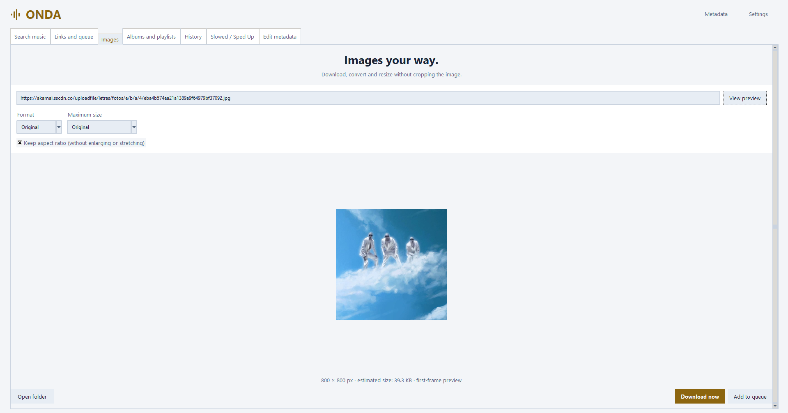</a> 
      Light · Gold
    </td>
    <td align="center" width="50%">
      <strong>Slowed, Sped Up and Reverb</strong> 
      <a href="docs/images/pc/en/efeitos-claro.png">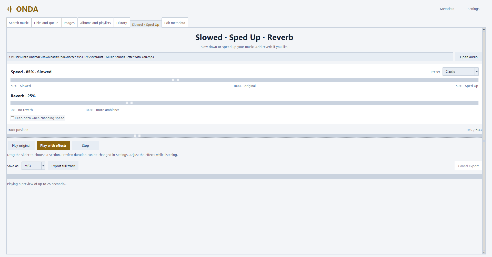</a> 
      Light · Gold
    </td>
  </tr>
</table>

More screenshots: [albums and playlists](docs/images/pc/en/album-preto-puro.png) · [compact history](docs/images/pc/en/historico-escuro.png) · [history cards](docs/images/pc/en/historico-cards-escuro.png) · [appearance](docs/images/pc/en/aparencia-escuro.png).

## ONDA on Android

Real screenshots of the app in light, dark and pure black themes. Screenshots show the English interface. Click an image to enlarge it.

<table>
  <tr>
    <td align="center" width="33%">
      <strong>Search music</strong> 
      <a href="docs/images/android/en/pesquisa-escuro.png">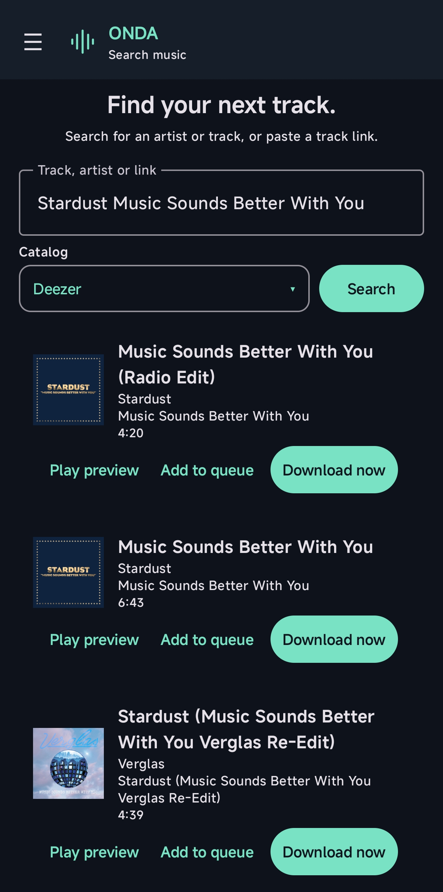</a> 
      Dark theme · Aqua 
      <a href="docs/images/android/en/album-escuro.png">View albums and playlists</a>
    </td>
    <td align="center" width="33%">
      <strong>Choose a format</strong> 
      <a href="docs/images/android/en/escolher-formato-escuro.png">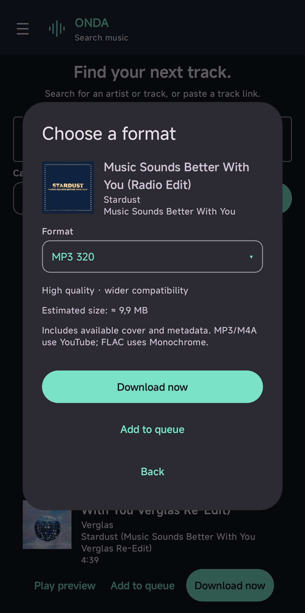</a> 
      Dark theme · Aqua
    </td>
    <td align="center" width="33%">
      <strong>Links and queue</strong> 
      <a href="docs/images/android/en/fila-preto-puro.png">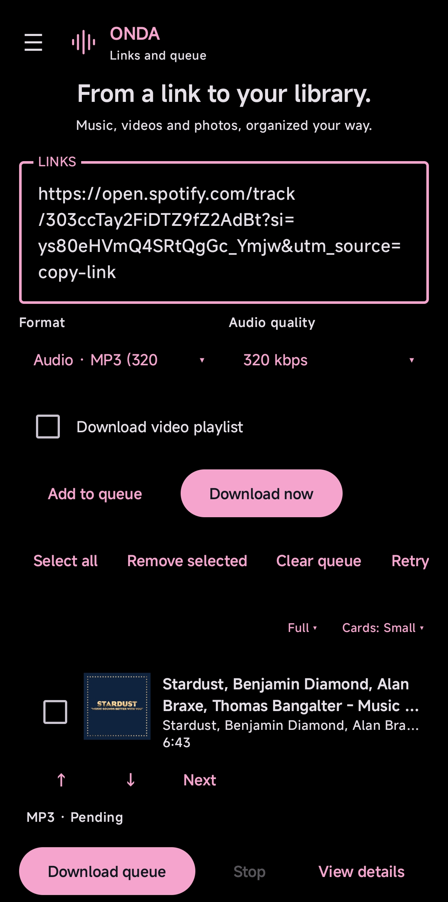</a> 
      Pure black · Pink
    </td>
  </tr>
  <tr>
    <td align="center" width="33%">
      <strong>Links and queue — full cards</strong> 
      <a href="docs/images/android/en/fila-claro.png">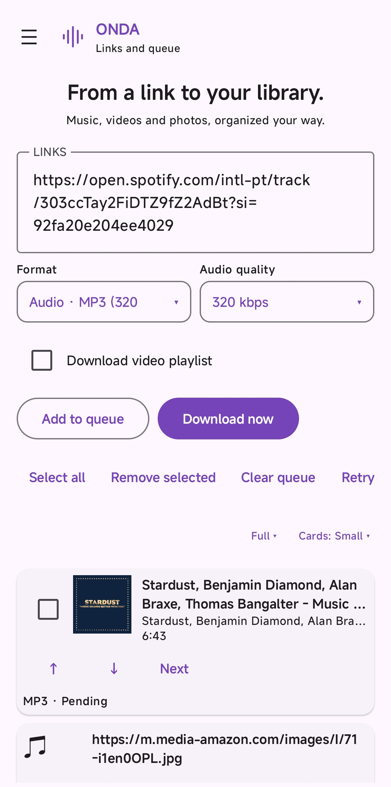</a> 
      Light theme · Purple
    </td>
    <td align="center" width="33%">
      <strong>Images</strong> 
      <a href="docs/images/android/en/imagens-claro.png">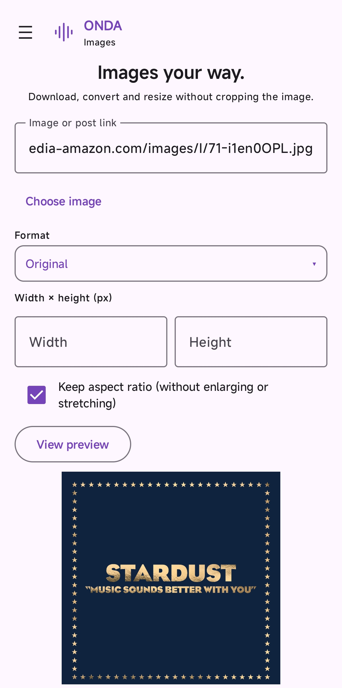</a> 
      Light theme · Purple
    </td>
    <td align="center" width="33%">
      <strong>Slowed, Sped Up and Reverb</strong> 
      <a href="docs/images/android/en/efeitos-claro.png">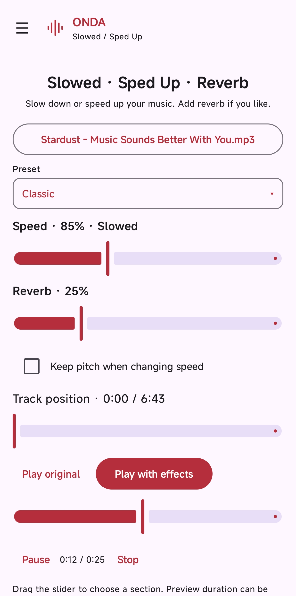</a> 
      Light theme · Red
    </td>
  </tr>
</table>

## Quick start

1. Choose the destination folder in **Settings**.
2. In **Links and queue**, paste a link, choose a format and select **Download now**, or add it to the queue.
3. In **Albums and playlists**, load a link or import a file, select the items and choose the download options.
4. Use **Images** to convert photos and **Effects** to edit a local track.

Albums use an `Artist - Album` subfolder; playlists use the playlist name. Detailed help is available in the [manual](Onda/README.md) (in Portuguese).

## Limitations

- Not every link is supported. Platforms may require login or cookies, or block access based on region/IP; website changes can interrupt downloads.
- ONDA does not remove DRM or obtain protected original audio from Spotify or Apple Music. Converting lossy audio to FLAC does not restore lossless quality.
- YouTube matching may find a different edition or version. Check the title, duration, artist and preview.
- Public Spotify playlists may return only part of the list. Connect your account or import a CSV for larger lists, when available.
- SVG files exported from photos contain the embedded image; they do not vectorize it.

Only download content you are authorized to access. Spotify, Apple Music, YouTube and other brands belong to their respective owners; ONDA is not affiliated with these platforms.

## Local data and privacy

On Windows, in both portable and installed modes, settings and history are stored in `%LOCALAPPDATA%\Onda`. FFmpeg, downloaded directly from its supplier, is stored in `tools/ffmpeg/9.0.2` inside that folder and reused without another download. The portable version stores preferences on the PC, outside the program folder. Spotify credentials are protected with Windows DPAPI. User-provided cookies should be treated as access credentials and must never be uploaded to GitHub.

The app connects to the selected platforms for search, metadata, artwork, previews and downloads. ONDA has no server of its own to receive your history. When reporting issues, remove credentials, cookies and personal information from logs.

## Issues and contributions

Open an [issue](https://github.com/enzoandradee16/Onda/issues) with your ONDA version, Windows or Android version, steps to reproduce the problem and the error message without personal information. See [CONTRIBUTING.md](CONTRIBUTING.md) and [SECURITY.md](SECURITY.md) (in Portuguese).

## License

Copyright (c) 2026 Enzo Andrade. ONDA's own code is released under **GPL-2.0-only**, without warranty. See [LICENSE](LICENSE). Dependencies and tools retain their respective licenses, described in [THIRD_PARTY_NOTICES.md](THIRD_PARTY_NOTICES.md).

When uninstalling the Windows app, you can keep your data or delete settings, the queue, history, saved accounts and the first-run record. Keeping data is the default; silent uninstallation also keeps it. A separate choice lets you remove tools downloaded by ONDA, such as FFmpeg. The cache is kept by default and is also preserved during silent uninstallation. Downloads, external cookies and tools in other folders are preserved. This data is shared between the installed and portable versions on the same PC.

## Queue and audio editing

Concurrent downloads, resuming, queue ordering, local tag/artwork/lyrics editing, normalization with preview, scheduling and preference transfer: see the [advanced features guide](RECURSOS-AVANCADOS.md) (in Portuguese).

## Measured performance

See the [startup, memory, CPU and download report](docs/DESEMPENHO.md), including the method, limitations and raw data. [Reproducible diagnostics](diagnosticos/README.md) are kept separate from the app. These documents are in Portuguese.

Later startup and list optimizations are documented in [Interface optimization](docs/OTIMIZACAO.md), with before-and-after comparisons.

Menu switching improvements and measurements: [Navigation and settings](docs/NAVEGACAO.md).
