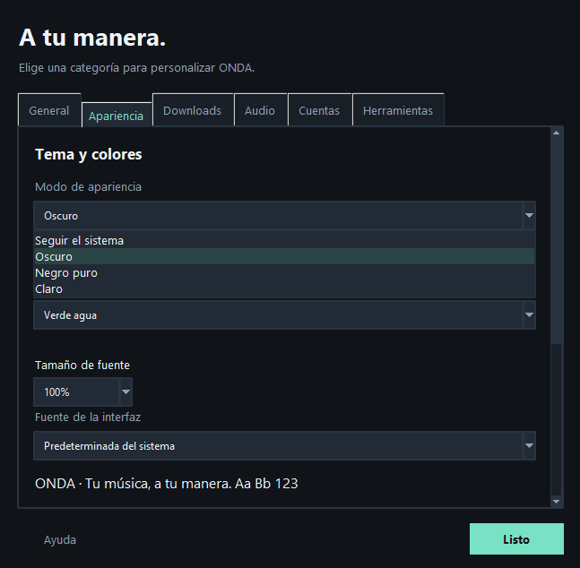

# ONDA

[Português (Brasil)](README.md) | **Español** | [English](README.en.md)

[Sitio oficial](https://enzoandradee16.github.io/Onda/)

Aplicación gratuita, de código abierto y **sin anuncios** para Windows y Android. Reúne herramientas para descargar, organizar y editar música, vídeos e imágenes, con interfaz en portugués y compatibilidad con español e inglés.

ONDA nació como un proyecto personal, creado inicialmente para mí y mis amigos. Decidí compartirlo con quienes también encuentren útil tener estas herramientas en un mismo lugar, sin anuncios y con opciones para personalizar la experiencia.

El proyecto sigue en desarrollo. Las sugerencias, contribuciones e informes de errores son bienvenidos.

**Versión 1.2.0 para Windows 10 o superior (x64) y Android 8 o superior (ARM64 y x86_64).**

En Android, las actualizaciones pueden descargarse dentro de ONDA, con progreso y continuidad en segundo plano. Al terminar, toca Instalar actualización; la primera vez, permite la instalación desde ONDA en los ajustes de Android. El sistema pide confirmación y tus datos se conservan.

En PC, haz clic derecho en las listas o tarjetas para abrir las acciones disponibles en esa pestaña. Mayús+F10 y la tecla de menú también abren estas opciones; la selección múltiple se conserva al hacer clic en uno de los elementos seleccionados.

## Novedades de la versión 1.2.0

- **Windows:** Descargar ahora en la búsqueda abre la elección de formato y calidad: MP3, M4A, FLAC o audio original. Parte de las preferencias guardadas. Permite descargar o añadir a la cola; cancelar no inicia nada. La elección se aplica a esa canción.
- **Minirreproductores del PC:** Efectos y Jukebox comparten el diseño, cada uno con portada, álbum, controles, volumen, letras y cola propios. Siguen visibles al minimizar ONDA. Apariencia permite elegir si ONDA se minimiza al abrirlos; el encabezado, la portada y los datos de la canción permiten mover la ventana.
- **Android:** navegación por Buscar, Descargas, Reproducción y Más, con En curso / Completados y Efectos / Jukebox usando el mismo selector redondeado de Guardados / Importar. Incluye reproductor ampliado, letras a pantalla completa y colas independientes.
- **Instalador propio:** “Tu ONDA empieza aquí.”, selección de carpeta y acceso directo, progreso y finalización. Portugués, español e inglés se eligen desde la apertura, incluidos los mensajes del desinstalador. No cambia el idioma guardado en la aplicación.
- **Desinstalador propio:** el mismo diseño del instalador, con “Hasta la próxima ONDA.”, tres idiomas y opciones independientes para borrar configuración/cola/historial y eliminar herramientas descargadas. Ambas empiezan desactivadas. Se conservan descargas, cookies externos y herramientas personales.

## Biblioteca y organización

- Detecta enlaces repetidos en la cola con el mismo formato y opciones, y en el historial con el mismo formato. Reconoce enlaces cortos, rutas de idioma y parámetros de uso compartido de Spotify, YouTube y Deezer; pide confirmación antes de añadirlos de nuevo. La detección se puede desactivar en Configuración → Descargas. Las distintas listas de reproducción, formatos y conversiones siguen siendo independientes.
- Edita metadatos por lotes a partir de varios archivos locales o de una selección múltiple en el Historial. Marca los campos que deseas cambiar y, si quieres, aplica una portada común. Se conservan los campos sin marcar. De forma predeterminada, crea copias; reemplazar los originales requiere confirmación. Cada archivo se guarda por separado y los fallos se indican al terminar.
- Ofrece carpetas por álbum, artista/año/álbum, género/artista/álbum y formato/artista/álbum, además de las opciones anteriores. Los nombres pueden incluir número de pista, artista, canción y disco. Configuración muestra una vista previa. Se conservan las carpetas de las listas de reproducción y se omiten los números de pista no disponibles.

En Android, la identificación por origen en el historial se registra en las nuevas descargas; las entradas antiguas sin enlace de origen no se identifican solo por su nombre de archivo. La detección no compara el audio ni considera los títulos parecidos como prueba de duplicación.

## Descargar y abrir

Descarga los paquetes oficiales desde [Releases](https://github.com/enzoandradee16/Onda/releases). Elige la versión para Windows o Android; el código fuente y las instrucciones de compilación también están disponibles en este repositorio.

- **Portátil:** extrae el ZIP completo y abre `Onda.exe`. Mantén las carpetas `Onda` y `_runtime` junto al ejecutable. No necesitas instalar Python. En el primer uso, ONDA descarga FFmpeg directamente de gyan.dev, con barra de progreso y verificación SHA-256; esta preparación inicial requiere conexión a Internet.
- **Instalador:** ejecuta `Onda-…-Setup-Windows-x64.exe`. La interfaz propia de ONDA permite elegir la carpeta, crear un acceso directo y seguir el progreso de la instalación. La instalación es por usuario, con desinstalador y compatibilidad con versiones anteriores. FFmpeg también se prepara automáticamente en el primer uso.
- **Android:** el APK está firmado con la clave de producción y requiere un dispositivo ARM64 con Android 8 o superior. El código fuente de las herramientas nativas recompiladas se incluye en el paquete Fontes-nativos-Android de la misma release.
- **Código fuente:** consulta las [instrucciones de desarrollo](Onda/README.md) (en portugués).

Los ejecutables de Windows no tienen firma digital. Windows puede mostrar un aviso de reputación; comprueba el origen y los hashes antes de ejecutarlos.

## Idioma

La versión 1.2.0 incluye **Português (Brasil)**, **Español** y **English**, en ese orden, en **Configuración → General → Idioma**. Los paquetes 1.2.0 están preparados localmente; publicarlos en GitHub es un paso aparte. Portugués sigue siendo el idioma predeterminado. El nombre **ONDA** se conserva en todos los idiomas. Ambas interfaces usan el mismo catálogo de traducción. En Android, el cambio es inmediato; en Windows, reinicia la aplicación. La elección se conserva aunque “Recordar configuración” esté desactivado. Los nombres de canciones, artistas, álbumes y archivos permanecen originales.

En Android, el icono de la pantalla de inicio y de aplicaciones recientes sigue el color de acento y los modos claro, oscuro, negro puro o del sistema. Algunos launchers pueden tardar en actualizar el icono o requerir volver a crear un acceso directo antiguo.

“Recordar configuración” está activado de forma predeterminada en PC y Android. Si lo desactivas manualmente, se respetará tu elección al volver a abrir.

En Android, los controles con símbolos, selectores, casillas y barras de reproducción/efectos exponen nombres y estados para TalkBack y servicios de accesibilidad. El recorte de portada ofrece acciones para mover la imagen sin arrastrarla. Las descripciones siguen el idioma elegido.

## Cola y reinicio

En **Enlaces** (Windows) o **Descargas** (Android), elige la vista compacta o en tarjetas y ajusta su tamaño con el control discreto de la propia pestaña. En Windows, **Ctrl + rueda del ratón** también cambia el tamaño de las tarjetas. Los tamaños de la cola y del historial son independientes. Las tarjetas completas muestran portada, artista, álbum, duración y otros metadatos proporcionados por la fuente. En Historial, Borrar historial, vista y tamaño están alineados horizontalmente y centrados debajo de la búsqueda. Las opciones de visualización también están en Apariencia. La vista y el tamaño de las tarjetas de la cola y del historial se conservan al volver a abrir, aunque “Recordar configuración” esté desactivado.

En Windows, **Reiniciar** aparece debajo de Idioma solo cuando hay un cambio de idioma pendiente. Volver al idioma actual elimina el cambio pendiente. El reinicio conserva la cola; las operaciones en curso deben terminar primero. En Android, el idioma y la apariencia cambian de inmediato, sin reiniciar.

## Funciones

- Busca música en Deezer, Apple Music y Spotify, obteniendo metadatos y portadas. La conexión con Spotify es opcional y amplía las funciones de búsqueda y listas de reproducción.
- Para canciones de catálogos de streaming, MP3/M4A usan una versión equivalente de YouTube. FLAC usa el catálogo Monochrome cuando hay una coincidencia compatible, con validación del audio y selección de versiones.
- Descarga enlaces de vídeo, audio e imágenes, incluidas publicaciones de redes sociales con varios elementos multimedia, cuando son accesibles.
- Ofrece cola persistente, descargas inmediatas, historial, selección multimedia y organización por carpetas.
- Importa álbumes y listas de reproducción, además de TXT, M3U y CSV de Exportify. Permite buscar en la lista y elegir opciones de formato y calidad propias.
- Convierte imágenes y crea versiones Slowed, Sped Up y Reverb, con ajustes preestablecidos, vista previa, navegación durante la reproducción y opción de mantener el tono.
- Ofrece temas claro, oscuro, negro puro y del sistema, 16 colores de acento y pestañas reordenables.

## ONDA en Windows

Capturas reales de la versión 1.2.0 en portugués. Haz clic para ampliar.

<table>
  <tr>
    <td align="center" width="50%"><strong>Buscar música</strong> </td>
    <td align="center" width="50%"><strong>Editar metadatos</strong> </td>
  </tr>
  <tr>
    <td align="center" width="50%"><strong>Imágenes</strong> </td>
    <td align="center" width="50%"><strong>Cola de descargas</strong> </td>
  </tr>
  <tr>
    <td align="center" width="50%"><strong>Efectos</strong> </td>
    <td align="center" width="50%"><strong>Jukebox infinito</strong> </td>
  </tr>
</table>

Más capturas: [Letras sincronizadas](docs/images/pc%20novo/letras-sincronizadas-claro.png) · [Minirreproductor con letras](docs/images/pc%20novo/miniplayer-jukebox-letras-preto-puro.png).

## ONDA en Android

Capturas reales de la versión 1.2.0 en portugués. Haz clic para ampliar.

<table>
  <tr>
    <td align="center" width="33%"><strong>Buscar música</strong> </td>
    <td align="center" width="33%"><strong>Descargas</strong> </td>
    <td align="center" width="33%"><strong>Álbumes y listas guardados</strong> </td>
  </tr>
  <tr>
    <td align="center" width="33%"><strong>Efectos</strong> </td>
    <td align="center" width="33%"><strong>Jukebox infinito</strong> </td>
    <td align="center" width="33%"><strong>Reproductor ampliado</strong> </td>
  </tr>
</table>

Más capturas: [Álbum y canciones](docs/images/android%20novo/album-discovery-escuro.png) · [Elección de formato](docs/images/android%20novo/escolha-formato-escuro.png) · [Letras a pantalla completa](docs/images/android%20novo/letras-tela-cheia-escuro.png) · [Cola de reproducción](docs/images/android%20novo/fila-reproducao-claro.png).

## Inicio rápido

1. Elige la carpeta de destino en **Configuración**.
2. En **Enlaces** (Windows) o **Descargas** (Android), pega el enlace, elige el formato y pulsa **Descargar ahora**, o añádelo a la cola.
3. En **Álbumes y listas de reproducción**, carga un enlace o importa un archivo, selecciona los elementos y elige las opciones de descarga.
4. Usa **Imágenes** para convertir fotos y **Efectos** para editar una canción local.

Los álbumes usan una subcarpeta `Artista - Álbum`; las listas usan su propio nombre. La ayuda detallada está en el [manual](Onda/README.md) (en portugués).

## Limitaciones

- No todos los enlaces son compatibles. Las plataformas pueden requerir iniciar sesión o cookies, o bloquear el acceso por región/IP; los cambios en sus sitios pueden interrumpir las descargas.
- ONDA no elimina DRM ni obtiene el audio original protegido de Spotify o Apple Music. Convertir audio con pérdidas a FLAC no recupera la calidad sin pérdidas.
- La búsqueda de coincidencias en YouTube puede encontrar otra edición o versión. Comprueba el título, la duración, el artista y la vista previa.
- Las listas públicas de Spotify pueden devolver solo parte del contenido. Conecta tu cuenta o importa un CSV para listas más grandes, cuando esté disponible.
- Un SVG exportado de una foto contiene la imagen incorporada; no la vectoriza.

Descarga solo contenido que estés autorizado a obtener. Spotify, Apple Music, YouTube y las demás marcas pertenecen a sus respectivos titulares; ONDA no está afiliado a estas plataformas.

## Datos locales y privacidad

En Windows, tanto en modo portátil como instalado, la configuración y el historial se guardan en `%LOCALAPPDATA%\Onda`. FFmpeg, obtenido directamente de su proveedor, se guarda en `tools/ffmpeg/9.0.2` dentro de esa carpeta y se reutiliza sin descargarlo de nuevo. La versión portátil guarda las preferencias en el ordenador, fuera de la carpeta del programa. Las credenciales de Spotify se protegen con DPAPI de Windows. Las cookies proporcionadas por el usuario deben tratarse como credenciales de acceso y nunca subirse a GitHub.

La aplicación se conecta con las plataformas consultadas para búsquedas, metadatos, portadas, vistas previas y descargas. ONDA no tiene un servidor propio que reciba el historial. Al informar de problemas, elimina credenciales, cookies y datos personales de los registros.

## Problemas y contribuciones

Abre una [issue](https://github.com/enzoandradee16/Onda/issues) con la versión de ONDA, la versión de Windows o Android, los pasos para reproducir el problema y el mensaje de error sin datos personales. Consulta [CONTRIBUTING.md](CONTRIBUTING.md) y [SECURITY.md](SECURITY.md) (en portugués).

## Licencia

Copyright (c) 2026 Enzo Andrade. El código propio de ONDA se distribuye bajo **GPL-2.0-only**, sin garantía. Consulta [LICENSE](LICENSE). Las dependencias y herramientas conservan sus respectivas licencias, descritas en [THIRD_PARTY_NOTICES.md](THIRD_PARTY_NOTICES.md).

Al desinstalar la aplicación de Windows, puedes conservar los datos o eliminar la configuración, la cola, el historial, las cuentas guardadas y el registro del primer inicio. La opción predeterminada es conservarlos; la desinstalación silenciosa también los conserva. Otra opción independiente permite eliminar las herramientas descargadas por ONDA, como FFmpeg. La caché se conserva de forma predeterminada y también durante la desinstalación silenciosa. Se conservan las descargas, las cookies externas y las herramientas de otras carpetas. Estos datos se comparten entre las versiones instalada y portátil en el mismo ordenador.

## Cola y edición de audio

Descargas simultáneas, reanudación, orden de la cola, edición local de etiquetas/portada/letra, normalización con vista previa, programación y transferencia de preferencias: consulta la [guía de funciones avanzadas](RECURSOS-AVANCADOS.md) (en portugués).

## Rendimiento medido

Consulta el [informe de inicio, memoria, CPU y descargas](docs/DESEMPENHO.md), con el método, las limitaciones y los datos originales. Los [diagnósticos reproducibles](diagnosticos/README.md) están separados de la aplicación. Estos documentos están en portugués.

Las optimizaciones posteriores de inicio y listas se documentan en [Optimización de la interfaz](docs/OTIMIZACAO.md), con comparaciones antes y después.

Mejoras y mediciones del cambio de menús: [Navegación y configuración](docs/NAVEGACAO.md).
