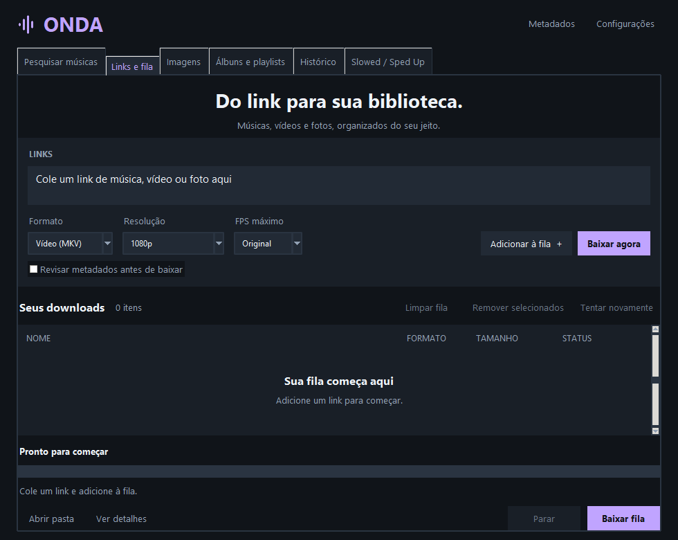
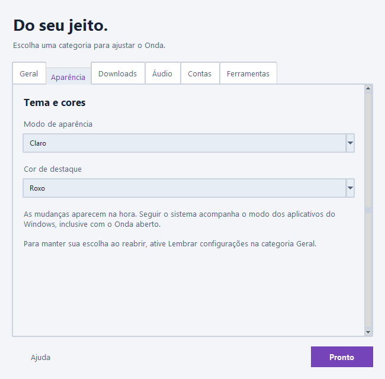

# ONDA

Aplicativo para Windows e Android para baixar e organizar músicas, vídeos e imagens, com interface em português.

**Versões em preparação: Windows 1.0.0-beta.2 · Android 1.0.0-alpha.2 (ARM64, Android 8 ou superior).**

## Baixar e abrir

Os pacotes ficam em [Releases](https://github.com/enzoandradee16/Onda/releases). Enquanto não houver uma release publicada, este repositório contém o código-fonte.

- **Portátil:** extraia o ZIP inteiro e abra `Onda.exe`. Mantenha as pastas `Onda` e `_runtime` junto dele. Não precisa instalar Python. No primeiro uso, o ONDA baixa o FFmpeg diretamente de gyan.dev, com barra de progresso e verificação SHA-256; é necessário acesso à internet nessa preparação.
- **Instalador:** execute o arquivo `Onda-…-Setup-Windows-x64.exe` e siga o assistente. A instalação é por usuário, com atalhos e desinstalador. O FFmpeg também é preparado automaticamente no primeiro uso.
- **Android:** o APK alpha.2 usa assinatura de produção e requer Android 8 ou superior, em aparelho ARM64. Os fontes das ferramentas nativas recompiladas são disponibilizados no pacote Fontes-nativos-Android da mesma release.
- **Código-fonte:** consulte [as instruções de desenvolvimento](Onda/README.md).

Os executáveis desta beta não têm assinatura digital. O Windows pode mostrar um aviso de reputação; confira a origem e os hashes antes de executar.

## O que faz

- Pesquisa músicas no Deezer, Apple Music e Spotify; obtém metadados e capas. A conexão com Spotify é opcional e amplia os recursos de pesquisa e playlists.
- Para músicas de streaming, MP3/M4A usam uma versão equivalente do YouTube. FLAC usa o acervo Monochrome quando houver uma correspondência compatível, com validação do áudio e seleção de versões.
- Baixa links de vídeo, áudio e imagem, incluindo publicações com múltiplas mídias de redes sociais, quando acessíveis.
- Oferece fila persistente, download imediato, histórico, seleção de mídias e organização por pastas.
- Importa álbuns e playlists, além de TXT, M3U e CSV do Exportify. Permite pesquisar na lista e escolher formato e qualidade próprios.
- Converte imagens e cria versões Slowed, Sped Up e Reverb, com presets, prévia, navegação na reprodução e opção de manter o tom.
- Tem modos claro, escuro e do sistema, 16 cores de destaque e abas reorganizáveis.

## Uso rápido

1. Escolha a pasta de destino em **Configurações**.
2. Em **Links e fila**, cole o link, escolha o formato e use **Baixar agora** ou adicione à fila.
3. Em **Álbuns e playlists**, carregue o link ou importe um arquivo, selecione os itens e escolha as opções de download.
4. Use **Imagens** para conversão de fotos e **Efeitos** para editar uma música local.

Álbuns usam uma subpasta `Artista - Álbum`; playlists usam o nome da playlist. A ajuda detalhada está no [manual](Onda/README.md).

## Limitações da beta

- Nem todo link é suportado. Plataformas podem exigir login, cookies ou bloquear o acesso por região/IP; mudanças nos sites podem interromper downloads.
- O ONDA não remove DRM nem obtém o áudio original protegido de Spotify ou Apple Music. Converter áudio com perdas para FLAC não recupera qualidade lossless.
- A correspondência no YouTube pode encontrar outra edição ou versão. Confira título, duração, artista e prévia.
- Playlists públicas do Spotify podem retornar apenas parte da lista. Conecte a conta ou importe um CSV para listas maiores, quando disponível.
- SVG exportado de uma foto contém a imagem incorporada; não faz vetorização.

Use apenas conteúdo que você tenha autorização para baixar. Spotify, Apple Music, YouTube e as demais marcas pertencem aos seus titulares; o ONDA não é afiliado a essas plataformas.

## Dados locais e privacidade

Nos modos portátil e instalado, configurações e histórico ficam em `%LOCALAPPDATA%\Onda`. O FFmpeg obtido diretamente do fornecedor fica em `tools/ffmpeg/9.0.2` dentro dessa pasta e é reutilizado sem novo download. A versão portátil mantém as preferências no PC, fora da pasta do programa. Credenciais Spotify são protegidas com DPAPI do Windows. Cookies fornecidos pelo usuário devem ser tratados como dados de acesso e nunca enviados ao GitHub.

O aplicativo faz conexões com as plataformas consultadas para pesquisa, metadados, capas, prévias e downloads. Não há servidor próprio do ONDA para receber o histórico. Ao relatar problemas, remova credenciais, cookies e dados pessoais dos logs.

## Problemas e contribuições

Abra uma [issue](https://github.com/enzoandradee16/Onda/issues) com a versão, Windows, passos para reproduzir e mensagem de erro sem dados pessoais. Consulte [CONTRIBUTING.md](CONTRIBUTING.md) e [SECURITY.md](SECURITY.md).

## Licença

Copyright (c) 2026 Enzo Andrade. O código próprio do ONDA é disponibilizado sob **GPL-2.0-only**, sem garantia. Consulte [LICENSE](LICENSE). Dependências e ferramentas mantêm suas respectivas licenças, descritas em [THIRD_PARTY_NOTICES.md](THIRD_PARTY_NOTICES.md).

Na desinstalação, você pode manter os dados ou apagar configurações, fila, histórico, contas salvas e o registro da primeira abertura. A escolha padrão é manter; desinstalação silenciosa também mantém. Uma segunda escolha independente permite remover as ferramentas baixadas pelo ONDA, como o FFmpeg. Por padrão, o cache é mantido; a desinstalação silenciosa também o preserva. Downloads, cookies externos e ferramentas de outras pastas são preservados. Esses dados são compartilhados entre as versões instalada e portátil no mesmo PC.

## Fila e edição de áudio

Downloads simultâneos, retomada, ordem da fila, edição local de tags/capa/letra, normalização com prévia, agendamento e transferência de preferências: consulte [o guia de recursos avançados](RECURSOS-AVANCADOS.md).

## Desempenho medido

Consulte o [relatório de abertura, memória, CPU e downloads](docs/DESEMPENHO.md), com método, limites e dados brutos. Os [diagnósticos reproduzíveis](diagnosticos/README.md) ficam separados do aplicativo.

A otimização posterior de abertura e listas está documentada em [Otimização de interface](docs/OTIMIZACAO.md), com comparação antes/depois.

Melhorias e medições da troca de menus: [Navegação e configurações](docs/NAVEGACAO.md).
